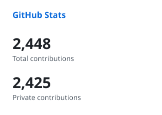
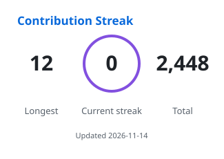

  

  

  
  
  

---

### 👋 About me

Full stack developer based in **Turin, Italy 🇮🇹**, building **trading infrastructure** and **AI-enabled applications** — from backend services and data pipelines to web interfaces and deployment.

- 🚀 **Technical Lead @ [FinRAG.tech](https://finrag.tech)** — a connected trading platform: market data, OMS, execution and risk controls
- 💼 **Full Stack Developer @ Rcalls** — AI-powered SaaS, Kubernetes & CI/CD, GPU fine-tuning workflows
- 🎓 Studying **Economics & Finance with Data Science** at the University of Turin
- 🌱 Currently exploring realtime voice agents and agentic AI for markets

### 🛠️ What I build

| | |
|---|---|
| ⚡ **Realtime trading systems** | Rust services, order management, broker reconciliation, risk controls |
| 📈 **Market data pipelines** | PostgreSQL / TimescaleDB + Redis with replay and gap recovery |
| 🤖 **AI applications** | RAG, agentic analysis, LLM APIs, realtime voice interaction |
| ☁️ **Cloud & DevOps** | Kubernetes, Docker, CI/CD, monitoring on AWS & GCP |

### 🧰 Tech stack

   
   
   
  

### 📊 GitHub stats

  <picture>
    <source media="(prefers-color-scheme: dark)" srcset="https://raw.githubusercontent.com/vm24/vm24/output/card-stats-dark.svg" />
    
  </picture>
  <picture>
    <source media="(prefers-color-scheme: dark)" srcset="https://raw.githubusercontent.com/vm24/vm24/output/card-streak-dark.svg" />
    
  </picture>

  

